<p align="center">
  <picture>
    <source media="(prefers-color-scheme: dark)" srcset="docs/assets/openmax-lockup-dark.svg">
    
  </picture>
</p>

<h3 align="center">A high-performance, self-extensible coding agent harness in Rust, optimized for prompt caching</h3>

<p align="center">
  One terminal binary that works with any OpenAI-compatible, Anthropic, or local model.<br>
  Keep the core small, write new tools and skills as files, and call them on the next step.
</p>

<p align="center">
  <a href="https://github.com/Max17190/open-max/releases/latest"></a>
  <a href="https://github.com/Max17190/open-max/actions/workflows/ci.yml"></a>
  <a href="LICENSE"></a>
</p>

<p align="center">
  
</p>

Open Max is one Rust binary: an agent loop, seven tools, a terminal UI that streams every step, and a core that keeps the trust decisions. Your own `AGENTS.md`, skills, memories and tools add to the built-in prompt, and `/context` shows what each one costs. When it needs a new capability, the agent writes it as a file, such as a [tool](docs/extending.md) or a skill, and can call a tool it wrote on its very next step. Within 100 ms of a `kill -9`, no process in the process groups of its tools is still running ([how](docs/execution.md)); a process that starts a session of its own (`setsid`) is out of reach, and a named tmux session is the way to keep work running on purpose.

**Your model.** It works with the model you already pay for or run: an eligible ChatGPT plan, an OpenAI or Anthropic key, or any compatible server, local ones included. `/model` switches between your endpoints inside a session.

**Better with use, as files.** The agent keeps what it learns as files the next session loads: memories under `.openmax/memory/`, and the tools and skills it wrote. `/memory` shows each memory and when it was last used, and `openmax --recall "<query>"` searches past sessions.

**Held to your checks.** [examples/run-task](examples/run-task/README.md) runs one task in your repository and refuses the end of the turn while a command you name fails, sending its output back to the model; after three refusals the turn ends `unverified`. Once Open Max has exited, the script runs your commands again itself and prints one JSON result: each check before and after the work, the patch, and a command that replays every step offline from one file, byte for byte.

## Install

```sh
curl -fsSL https://useopenmax.dev/install.sh | sh    # macOS and Linux
brew install Max17190/tap/openmax                    # Homebrew
npm install -g openmax-cli                           # or: bun install -g openmax-cli
```

The script adds `openmax` to your `PATH` for new shells; open one, or run `source ~/.openmax/bin/env`.

## Get started

```sh
openmax --login     # ChatGPT, an OpenAI or Anthropic key, or any compatible API
cd ~/code/my-app
openmax
```

On first setup, API login saves the model you choose as the default. After
browser sign-in, choose a model with `/model`. You can use `/model` to change
your selection later. Once a model is selected, describe a task.

Open Max asks before it works in a new project. Its shell commands, tools and hooks run with your user's access. It has no telemetry: besides your model endpoint (and OpenAI's sign-in service for a ChatGPT account), the one other call it makes is a version check to `api.github.com`, at most once a day from an interactive session of an installed release, which `OPENMAX_NO_UPDATE_CHECK=1` turns off. For your own model server, see [getting started](docs/getting-started.md). For scripts and CI, see [unattended runs](docs/unattended.md). Setting up with a coding agent? Point it at [useopenmax.dev/setup.md](https://useopenmax.dev/setup.md).

## Docs

[Install](docs/install.md) · [Getting started](docs/getting-started.md) · [FAQ](docs/faq.md) · [Configuration](docs/configuration.md) · [Usage](docs/usage.md) · [Extending](docs/extending.md) · [Design](docs/design.md) · [Native execution and privacy](docs/execution.md) · [Hold a run to your own checks](docs/verified-execution.md) · [stdio protocol](docs/stdio-protocol.md) · [Development](docs/development.md)

## License

MIT
